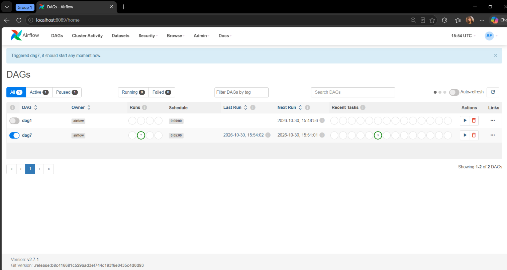
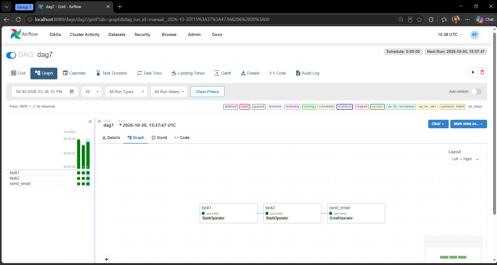

# Apache Airflow – Bash & Email Operators

## Project Overview

This project demonstrates how to create and execute an Apache Airflow DAG using different operators to automate a simple workflow.

The DAG consists of BashOperator and EmailOperator to execute commands and send an email notification after the pipeline finishes successfully.

## Technologies Used

- Python
- Apache Airflow
- BashOperator
- EmailOperator
- Docker

## Workflow Description

The DAG contains three tasks:

1. **Task 1 – Pipeline Start:** Executes a Bash command to print a pipeline started message.
2. **Task 2 – Python Script Execution:** Runs a Python script using BashOperator.
3. **Task 3 – Email Notification:** Sends an email notification when the previous tasks finish successfully.

## Workflow Structure

```text
Task 1: Pipeline Started
          |
          v
Task 2: Run Python Script
          |
          v
Task 3: Send Email
```

## Screenshots

### Airflow DAG


### Successful DAG Execution


## How to Run

1. Clone the repository:

```bash
git clone YOUR_REPOSITORY_URL
```

2. Navigate to the project directory:

```bash
cd cloud
```

3. Start Airflow:

```bash
docker compose -f airflow.yaml up -d
```

4. Open Airflow in your browser:

http://localhost:8080

5. Enable the DAG and trigger it from the Airflow UI.

## Email Configuration

The EmailOperator requires SMTP configuration.

For Gmail:

- SMTP Host: smtp.gmail.com
- SMTP Port: 587
- Encryption: STARTTLS

Use a Gmail App Password and keep all credentials private.

## Author

**Kenzy Ahmed**

Computer Science & Artificial Intelligence Student

GitHub: [kenzyahmed0](https://github.com/kenzyahmed0)